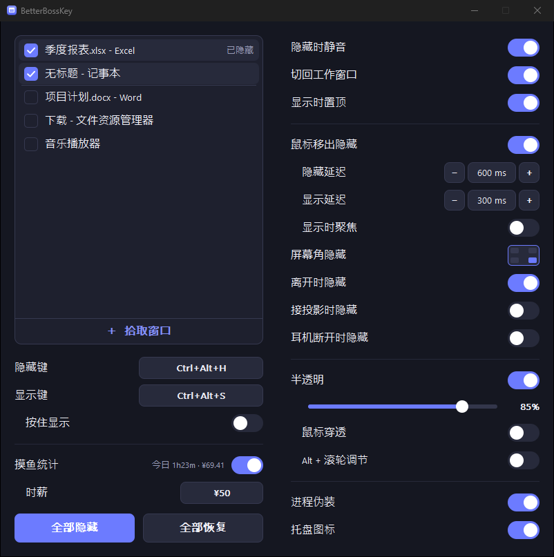

# BetterBossKey

[简体中文](README.md) | **English**

> A lightweight Windows boss key: hide windows, make them translucent, or tuck them away when the mouse leaves. One file, zero dependencies, modern dark UI.

BetterBossKey is a small tool written in **Rust + raw Win32 API**. It builds into **a single ~320 KB standalone exe** with the C runtime statically linked, so end users **don't need .NET, the VC++ redistributable, or anything else**. Just double-click it.

**[⬇️ Download the latest release](https://github.com/MayflyOvO/BetterBossKey/releases/latest)**



> The interface is in Simplified Chinese. UI labels are quoted below in Chinese with an English translation, e.g. **隐藏键** (Hide key).

## ✨ Features

| Feature | Description |
| --- | --- |
| 🫥 **One-key hide (boss key)** | A global hotkey hides / restores every checked window at once. Hotkeys can be **keyboard combos** (default `Ctrl+Alt+H`) **or the middle / side mouse buttons** (optionally with modifiers) to clear the screen instantly |
| 🕶️ **Process disguise** | Runs as a **fixed-alias copy** (e.g. `%LOCALAPPDATA%\NovaSync\NovaSync.exe`; the alias is random on first run and then stays the same). Both the name and folder layout look like any ordinary small app, so "BetterBossKey" never shows up in Task Manager / tasklist, and it doesn't stand out the way a random name would. Toggle it in settings (the app restarts to apply). **Note: this only makes the name inconspicuous. It is not stealth against antivirus / EDR**, and it never pretends to be a system process |
| ⌨️ **Separate hide and show keys** | Hide and show can each have their own hotkey (e.g. `Ctrl+Alt+H` to hide, `Ctrl+Alt+S` to show). **Set both to the same key and it becomes a toggle** (press once to hide, again to show) |
| 🖱️ **Auto-hide on mouse leave, auto-show on return** | Managed windows hide when the mouse leaves them and reappear when the mouse returns to **where the window used to be**, like an auto-hide panel. **Hide delay** and **show delay** are adjustable independently; optional **focus on show** brings the window to the foreground (turn it off to just show it without stealing focus) |
| 🌫️ **Window translucency** | A slider sets the opacity of managed windows (20%–100%) in real time. It's reapplied periodically **so the target app can't reset it** |
| 🎯 **Visual window picker** | Lists all current windows; check the ones to manage (**checked windows float to the top, unchecked ones return to their place**) |
| ♻️ **Survives restarts** | Remembers each selected window's **process name + class name + title**. Whether you restart BetterBossKey or **the target app itself**, the window is re-attached and its settings (e.g. translucency) are restored as soon as it reappears |
| 🎯 **Pick a window** | Click **＋ 拾取窗口** (Pick window) at the bottom of the list to enter pick mode: the settings window hides, the window under the cursor gets a **red frame** with its **process name / title / size** in the top-left corner. **Left-click** to select, **right-click or Esc** to cancel |
| 🔔 **Lives in the system tray** | Closing the settings window keeps it running in the tray; the tray menu can hide all / restore all / exit in one click |
| 🎨 **Modern dark GUI** | DWM dark title bar + rounded corners (Win11), Segoe UI, fully custom-drawn controls, flicker-free double buffering, high-DPI aware |

> On exit, every window it hid or made translucent is **restored**, so your windows never get "lost". As a safety net, all hidden windows are tracked: even on a **crash** (panic) or **sign-out / shutdown**, it does its best to bring them back. (The only exception is being force-killed from Task Manager, where no cleanup code can run.)

## 🚀 Usage

1. Run `BetterBossKey.exe`.
2. Check the windows you want to manage in the list at the top (it refreshes automatically), or click **＋ 拾取窗口** (Pick window) at the bottom of the list and move the mouse over the target (a red frame and process name appear). **Left-click** to select, **right-click / Esc** to cancel.
3. Turn on features as needed:
   - **隐藏键 / 显示键** (Hide key / Show key): click the key box, then press the **keyboard combo** you want, or the **middle / side mouse button** (Ctrl/Alt/Shift can be held at the same time). Set them to **different** combos to hide and show separately; set them to the **same** combo to use it as a toggle (press once to hide, again to show).
     > When a mouse button is used, it is "claimed" as the boss key (its default action is blocked while pressed). An otherwise unused **side button** is recommended.
   - **鼠标移出隐藏** (Hide on mouse leave): turn on the switch and adjust **隐藏延迟 / 显示延迟** (Hide delay / Show delay) below it as needed. Windows hide when the mouse leaves them and show again when it returns to where the window was (windows hidden by the boss key are unaffected and still need the boss key). If you want to interact with the window right away when it appears, also turn on **显示时聚焦** (Focus on show). While the switch is off, these sub-options are dimmed and disabled.
   - **半透明** (Translucency): turn on the switch and drag the slider.
4. **Survives restarts**: selected windows are remembered and re-attached with their settings after restarting this app or the target app.
5. Click the window's close button → the app goes to the **system tray** and keeps running (right-click the tray icon for the menu).
6. **进程伪装** (Process disguise, on by default): the app runs as a copy at `%LOCALAPPDATA%\<alias>\<alias>.exe`; the original exe only launches the copy and exits. The alias (e.g. `NovaSync`) is random on first run and then **stays the same**. Real software never changes its process name, so "a weird new name every time" would stand out more. Toggling the switch restarts the app to apply immediately; the copy is always the same file, overwritten each time, so nothing piles up.

> If a key box turns red and shows **被占用** (In use), that combo is already taken by another app on the system (e.g. another boss-key tool). Click it and pick a different combo.

## 🛠️ Building from source

Requires [Rust](https://rustup.rs/) (MSVC toolchain, the Windows default):

```bash
cargo build --release
# Output: target/release/BetterBossKey.exe
```

Size optimizations (static CRT + LTO + `opt-level=z` + `strip`) are already configured in `Cargo.toml` / `.cargo/config.toml`; nothing else to do.

- **Only dependency**: [`windows-sys`](https://crates.io/crates/windows-sys) (compile time only, Win32 FFI bindings).
- **Runtime dependencies**: only the system's own `user32 / gdi32 / shell32 / dwmapi / kernel32`; no third-party DLLs.

## 🧩 Architecture (modular)

```
build.rs             Build script: embeds the manifest and icon resources (no rc.exe or other external tools)
build/
└── icon.rs          Icon design (drawn in pure Rust, 16–256px) and PNG / ICO / .res encoding
src/
├── main.rs          Entry point, window class registration, message loop & WndProc dispatch, tray menu, single instance
├── app.rs           App state and core logic (boss key / auto-hide timers / translucency)
├── config.rs        Config persistence (%APPDATA%\BetterBossKey\config.ini, minimal key=value)
├── util.rs          Wide strings, colors and other small helpers
├── win/             —— Win32 wrapper layer ——
│   ├── window.rs     Top-level window enumeration, hide/show, translucency, hidden-window registry (crash recovery)
│   ├── hotkey.rs     Global hotkey model (keyboard / mouse) and string parsing
│   ├── mouse_hook.rs Global low-level hook for the middle / side mouse buttons
│   ├── overlay.rs    Pick-mode red frame + info bar overlay (color-keyed layered window)
│   ├── tray.rs       System tray icon
│   ├── disguise.rs   Process disguise: run as a fixed-alias copy, hand-off restart on toggle
│   ├── icon.rs       Loads the icon from exe resources per DPI (shared by exe / window / tray)
│   └── mod.rs        DPI helpers
└── gui/             —— UI layer ——
    ├── theme.rs     Colors and fonts
    ├── widgets.rs   Drawing primitives: anti-aliased rounded rects / circles / checkmarks (DIB pixels) + GDI text
    └── ui.rs        Layout, double-buffered painting and mouse/keyboard interaction
```

Example config file (`%APPDATA%\BetterBossKey\config.ini`):

```ini
hide_hotkey=Ctrl+Alt+H   # Hide key; can also be 中键 (middle) / 侧键1 (side 1) / 侧键2 (side 2) / Ctrl+侧键1, etc.
show_hotkey=Ctrl+Alt+S   # Show key; same as hide_hotkey means toggle
auto_hide=0
auto_hide_delay_ms=600   # Delay before hiding after the mouse leaves
reveal_delay_ms=300      # Delay before showing after the mouse returns
auto_focus=0             # Bring the window to the foreground when revealed by mouse
opacity=85
transparency_enabled=0
disguise=1              # Process disguise: run as a fixed-alias copy (alias= is an internal key holding the disguise name; origin= is an internal key holding the original exe path)
target=phoneCast.exe	CabinetWClass	投屏窗口   # process name<TAB>class name<TAB>title, used to re-match across restarts
```

## 📄 License

[MIT](LICENSE) © MayflyOvO
