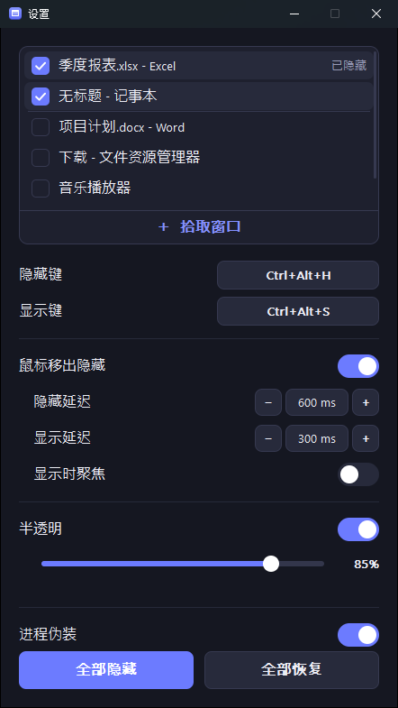

# BetterBossKey

**简体中文** | [English](README.en.md)

> 轻量级 Windows 窗口隐藏 / 半透明 / 老板键工具 —— 单文件、零依赖、现代深色界面。

BetterBossKey 是一个用 **Rust + 原生 Win32 API** 写的小工具，编译后是**一个约 320 KB 的独立 exe**，静态链接 C 运行时，终端用户**无需安装 .NET、VC++ 运行库或任何其它依赖**，双击即用。

**[⬇️ 下载最新版](https://github.com/MayflyOvO/BetterBossKey/releases/latest)**



## ✨ 功能

| 功能 | 说明 |
| --- | --- |
| 🫥 **一键隐藏指定窗口（老板键）** | 全局热键一键隐藏 / 恢复所有勾选的窗口。热键支持**键盘组合键**（默认 `Ctrl+Alt+H`）**以及鼠标中键 / 侧键**（可带修饰键），瞬间“清场” |
| 🕶️ **进程伪装** | 启动时以**固定别名副本**运行（如 `%LOCALAPPDATA%\NovaSync\NovaSync.exe`，别名首次随机生成、之后固定）：名字与目录布局都与正常小软件无异，任务管理器 / tasklist 里既不出现 "BetterBossKey"，也不会像随机名那样惹眼。可在设置里一键开关（开关即重启生效）。**注意：只是“名字不显眼”，不是对杀毒 / EDR 的隐身**，也不伪装成系统进程 |
| ⌨️ **隐藏键 / 显示键可分别设置** | 隐藏和显示可各设一个热键（如 `Ctrl+Alt+H` 隐藏、`Ctrl+Alt+S` 显示）；**两者设为同一个键时自动作为切换键**（按一下隐藏、再按一下显示） |
| 🖱️ **鼠标移出隐藏 / 移回原位自动显示** | 鼠标离开受管窗口后自动隐藏；移回该窗口**原来所在的位置**时又自动显示（自动隐藏面板效果，可反复触发）。**隐藏延迟**与**显示延迟**均可独立调节；可选**移入时自动聚焦**（唤出后把窗口切到前台，关闭则只显示不打断当前操作） |
| 🌫️ **窗口半透明** | 用滑块调节受管窗口的不透明度（20%–100%），实时生效；定期重申，**防止目标程序自行重置透明度** |
| 🎯 **可视化选择目标窗口** | 列出当前所有窗口，勾选要管理的窗口（**勾选后自动置顶、取消后回到原位**） |
| ♻️ **跨重启自动恢复** | 记住所选窗口的**进程名 + 类名 + 标题**：无论重启 BetterBossKey 还是**重启目标软件本身**，只要它再次出现就自动重新挂接并恢复半透明等设置 |
| 🎯 **拾取窗口** | 点列表底部的“＋ 拾取窗口”进入拾取模式：设置窗口隐藏，鼠标悬停的窗口被**红框**框住并在左上角显示**进程名 / 标题 / 尺寸**；**左键**选中、**右键或 ESC** 取消 |
| 🔔 **系统托盘常驻** | 关闭设置窗口后退到托盘继续运行；托盘菜单可一键全部隐藏 / 恢复 / 退出 |
| 🎨 **现代深色 GUI** | DWM 暗色标题栏 + 圆角（Win11）、Segoe UI、全自绘控件、双缓冲无闪烁、高 DPI 自适应 |

> 退出程序时会自动**恢复**所有被它隐藏 / 半透明的窗口，不会把你的窗口“弄丢”。为防意外，程序还登记了所有被隐藏的窗口：即使**异常崩溃**（panic）或**注销 / 关机**，也会尽力把它们恢复出来。（仅“任务管理器强制结束进程”这种无法执行任何收尾代码的情况例外。）

## 🚀 使用

1. 运行 `BetterBossKey.exe`。
2. 在顶部的窗口列表里勾选要管理的窗口（列表自动刷新），或点列表底部的 **＋ 拾取窗口** 后把鼠标移到目标上（出现红框 + 进程名），**左键**选中、**右键 / ESC** 取消。
3. 各功能按需开启：
   - **隐藏键 / 显示键**：点击对应的按键框，按下你想要的**键盘组合键**，或**鼠标中键 / 侧键**（可同时按住 Ctrl/Alt/Shift）。两个键设成**不同**组合即可分别隐藏 / 显示；设成**相同**组合则作为切换键（按一下隐藏、再按一下显示）。
     > 设为鼠标键后，该按键会被本程序“独占”用作老板键（按下时其默认功能被拦截）。建议用不常用的**侧键**。
   - **鼠标移出隐藏**：打开开关，并按需调整其下的 **隐藏延迟 / 显示延迟**。鼠标离开窗口会自动隐藏它，鼠标移回该窗口原来的位置又会自动显示（老板键隐藏的窗口不受此影响，仍需按老板键唤出）。需要唤出后立刻操作该窗口时，可一并打开 **显示时聚焦**。开关关闭时，这些子项变暗不可调。
   - **半透明**：打开开关并拖动滑块。
4. **跨重启自动恢复**：所选窗口会被记住，重启本程序或重启目标软件后会自动重新挂接并恢复设置。
5. 点窗口的关闭按钮 → 程序退到**系统托盘**继续运行（右键托盘图标有菜单）。
6. **进程伪装**（默认开启）：程序以 `%LOCALAPPDATA%\<别名>\<别名>.exe` 的副本运行，原始 exe 只负责拉起副本后退出。别名（如 `NovaSync`）首次随机生成、之后**保持不变**——正常软件的进程名从不变化，“每次换一个怪名字”反而更显眼。切换“进程伪装”开关时程序会自动重启以立即生效；副本始终是同一个文件，每次覆盖，不产生垃圾。

> 若按键框变红并显示 **“被占用”**，说明该组合键已被系统中其它软件（例如其它老板键工具）占用，点击改一个别的组合键即可。

## 🛠️ 从源码构建

需要 [Rust](https://rustup.rs/)（MSVC 工具链，Windows 默认）：

```bash
cargo build --release
# 产物：target/release/BetterBossKey.exe
```

体积优化（静态 CRT + LTO + `opt-level=z` + `strip`）已在 `Cargo.toml` / `.cargo/config.toml` 配好，无需额外操作。

- **唯一依赖**：[`windows-sys`](https://crates.io/crates/windows-sys)（仅编译期，Win32 FFI 绑定）。
- **运行期依赖**：仅系统自带的 `user32 / gdi32 / shell32 / dwmapi / kernel32`，无第三方 DLL。

## 🧩 架构（模块化）

```
build.rs             构建脚本：嵌入 manifest 与图标资源（不依赖 rc.exe 等外部工具）
build/
└── icon.rs          图标设计（纯 Rust 绘制，16–256px）与 PNG / ICO / .res 编码
src/
├── main.rs          入口、窗口类注册、消息循环与 WndProc 分发、托盘菜单、单实例
├── app.rs           应用状态与核心业务逻辑（老板键 / 自动隐藏计时 / 半透明）
├── config.rs        配置持久化（%APPDATA%\BetterBossKey\config.ini，极简 key=value）
├── util.rs          宽字符串、颜色等小工具
├── win/             —— Win32 封装层 ——
│   ├── window.rs     顶层窗口枚举、隐藏/显示、半透明、隐藏登记表（崩溃兜底恢复）
│   ├── hotkey.rs     全局热键模型（键盘 / 鼠标）与字符串解析
│   ├── mouse_hook.rs 鼠标中键 / 侧键的全局低级钩子
│   ├── overlay.rs    拾取模式的红框 + 信息条覆盖窗（颜色键分层窗）
│   ├── tray.rs       系统托盘图标
│   ├── disguise.rs   进程伪装：以固定别名副本运行、切换时接力重启
│   ├── icon.rs       按 DPI 从 exe 资源加载图标（exe / 窗口 / 托盘共用同一份）
│   └── mod.rs        DPI 工具
└── gui/             —— 界面层 ——
    ├── theme.rs     配色与字体
    ├── widgets.rs   绘制原语：抗锯齿圆角矩形 / 圆 / 对勾（DIB 像素）+ GDI 文字
    └── ui.rs        布局、双缓冲绘制与鼠标/键盘交互
```

配置文件示例（`%APPDATA%\BetterBossKey\config.ini`）：

```ini
hide_hotkey=Ctrl+Alt+H   # 隐藏键；也可为 中键 / 侧键1 / 侧键2 / Ctrl+侧键1 等
show_hotkey=Ctrl+Alt+S   # 显示键；与 hide_hotkey 相同时即为切换键
auto_hide=0
auto_hide_delay_ms=600   # 鼠标移出后隐藏延迟
reveal_delay_ms=300      # 鼠标回到原位后显示延迟
auto_focus=0             # 移回原位唤出时是否把窗口切到前台
opacity=85
transparency_enabled=0
disguise=1              # 进程伪装：以固定别名副本运行（alias= 为内部键，记录伪装用的进程名；origin= 为内部键，记录原始 exe 路径）
target=phoneCast.exe	CabinetWClass	投屏窗口   # 进程名<TAB>类名<TAB>标题，用于跨重启再匹配
```

> 兼容旧版：旧的 `hotkey=` 会被读作隐藏键与显示键同一个键（即切换键）；只有标题的旧 `target=` 行仍可识别。

## 📄 许可证

[MIT](LICENSE) © MayflyOvO
